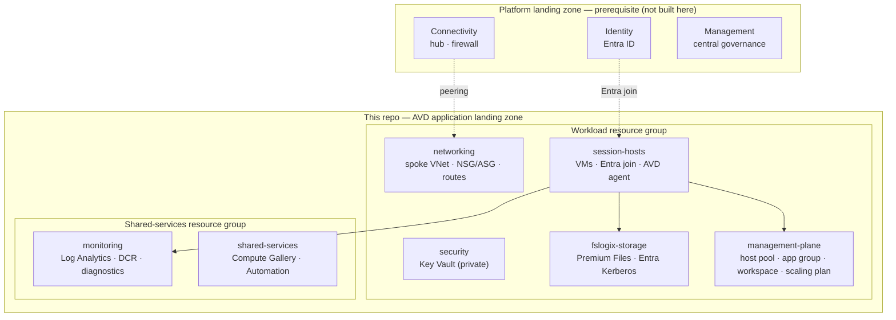

# Azure Virtual Desktop — Landing Zone (IaC)

Terraform Infrastructure-as-Code for an **Azure Virtual Desktop (AVD) application landing zone**,
following the Microsoft [AVD Landing Zone design guide](https://learn.microsoft.com/en-us/azure/architecture/landing-zones/azure-virtual-desktop/design-guide)
and the [`Azure/avdaccelerator`](https://github.com/Azure/avdaccelerator) baseline. Composed entirely from
**[Azure Verified Modules (AVM)](https://azure.github.io/Azure-Verified-Modules/)** and delivered through
**GitHub Actions** with **OIDC** — no stored cloud secrets.

> This is an **application** landing zone. It assumes a CAF **platform** landing zone (connectivity,
> identity, management) already exists — see [Prerequisites](#prerequisites). Stack: **Terraform + AVM only.**

---

## Architecture



Full design-area (A–I) mapping, AVM version matrix, and RTO/RPO: **[ARCHITECTURE.md](ARCHITECTURE.md)**.

## What gets deployed

| Module | Resources | AVM |
|--------|-----------|-----|
| `networking` | Spoke VNet, NSG (reverse-connect), ASG, route table, optional hub peering | network/* |
| `identity-join` | Identity-mode config (Entra ID join baseline) — no DCs deployed | (config) |
| `fslogix-storage` | Premium Azure Files (Entra Kerberos) + file private endpoint | storage-storageaccount |
| `security` | Key Vault (RBAC, private endpoint) + private DNS | keyvault-vault |
| `management-plane` | Host pool, application group, workspace, scaling plan | desktopvirtualization/* |
| `session-hosts` | Session-host VMs + Entra join + AVD agent registration | compute-virtualmachine |
| `monitoring` | Log Analytics + AVD data collection rule + diagnostics | operationalinsights, insights/dcr |
| `shared-services` | Compute Gallery + Automation account | compute-gallery, automation |

Composition root: [`landing-zones/avd-workload/`](landing-zones/avd-workload).

## Repository layout

```
ARCHITECTURE.md  CLAUDE.md  PROMPT.md  WORKLOG.md  DECISIONS.md  OPEN-QUESTIONS.md   Governance
.github/workflows/    plan-on-pr.yml (PR plan), manual-deploy.yml (dispatch plan/apply/destroy)
bootstrap/            one-time: OIDC federation + Terraform state backend (CMK)
modules/              the eight AVD modules above
landing-zones/avd-workload/   composition root (calls the modules)
envs/                 dev/prod tfvars + backend.hcl (placeholders)
policies/             optional guardrails
docs/                 naming/tagging, role workflow, acceptance
```

## Prerequisites

1. A deployed **CAF platform landing zone** (connectivity / identity / management). Not created here.
2. **Microsoft Entra ID join** for session hosts is the baseline (ADR-0003); Entra Kerberos enables
   FSLogix on Azure Files. (`entra-ds` / `ad-ds` are toggle options.)
3. Tooling: **Terraform ≥ 1.9**, `azurerm` ≥ 4, Azure CLI (plus `azuread` ≥ 3 for `bootstrap/` only).
   On Windows, set `git config --global core.longpaths true` (AVM modules nest deeply).
4. Subscription(s) for the AVD **workload** (+ optional shared-services).

## Deploy

```bash
# 1) One-time bootstrap (OIDC federation + state backend) — see bootstrap/README.md
cd bootstrap && terraform init && terraform apply -var-file=terraform.tfvars

# 2) Fill the <PLACEHOLDER>s in envs/<env>.backend.hcl and envs/<env>.tfvars from the outputs,
#    and set the GitHub repo variables AZURE_CLIENT_ID / AZURE_TENANT_ID / AZURE_SUBSCRIPTION_ID.

# 3) CI: PRs run plan (dev) via plan-on-pr. Deploys are explicit — run the manual-deploy workflow
#    (Actions → manual-deploy → env + plan/apply/destroy; prod apply/destroy gated by the 'production'
#    Environment). Or run locally:
cd landing-zones/avd-workload
terraform init -backend-config=../../envs/dev.backend.hcl
terraform plan -var-file=../../envs/dev.tfvars
```

## Configuration

Common knobs in `envs/*.tfvars` (full list: [`landing-zones/avd-workload/variables.tf`](landing-zones/avd-workload/variables.tf)):

| Variable | Default | Purpose |
|----------|---------|---------|
| `deploy_networking` | `true` | Deploy the spoke VNet. `false` requires existing subnet IDs (gates FSLogix, KV PE, session hosts). |
| `identity_mode` | `entra-id-join` | Session-host identity model (`entra-id-join` · `entra-ds` · `ad-ds`). |
| `host_pool_type` | `Pooled` | `Pooled` or `Personal`. |
| `max_sessions_allowed` | `8` | Max sessions per host (Pooled). |
| `deploy_scaling_plan` | `true` | Autoscale plan (Pooled only). |
| `session_host_count` | `2` | Number of session-host VMs (`0` deploys none). |
| `session_host_vm_size` | `Standard_D4as_v5` | Session-host VM size. |
| `session_host_encryption_at_host` | `true` | Requires the `Microsoft.Compute/EncryptionAtHost` feature — set `false` if not registered. |
| `fslogix_share_quota_gb` | `128` | FSLogix profile share size (Premium FileStorage, > 100). |

## CI/CD

- **`plan-on-pr.yml`** — `terraform fmt` + `validate` + `plan` (dev) on every pull request. No apply.
- **`manual-deploy.yml`** — on-demand `workflow_dispatch` for **plan / apply / destroy** against a chosen
  environment (dev|prod) — the **only** apply path. apply/destroy require typing the environment name to
  confirm; prod apply/destroy run under the `production` Environment gate (required reviewer). Use this for
  all deploys and the destroy-dev-before-prod step. (There is intentionally **no merge-triggered apply** —
  every deploy is an explicit, confirmed action.)
- **`cleanup-demo.yml`** — DESTRUCTIVE demo reset (`workflow_dispatch`). Brute-force `az group delete` of
  the project RGs (`rg-avd-*`), with an `include_state_backend` toggle for `rg-tfstate-avd-001`. Guarded by
  typing the subscription ID to confirm + the `production` Environment gate. Use to wipe the demo sub
  between runs.
- Auth is **OIDC federated** (`azure/login`); pinned action versions; no long-lived secrets. The federated
  credentials are created by `bootstrap/`.

## Before the first apply

- Open questions OQ-006/007/008 are all **resolved** ([OPEN-QUESTIONS.md](OPEN-QUESTIONS.md)). The one
  operational step that remains: register `Microsoft.Compute/EncryptionAtHost` on the subscription
  (`az feature register --namespace Microsoft.Compute --name EncryptionAtHost`), or set
  `session_host_encryption_at_host = false` in `envs/*.tfvars` if it isn't registered.
- Replace every `<PLACEHOLDER>` in `envs/*` and `bootstrap/terraform.tfvars` (never committed).

## Teardown

```bash
# Destroy the workload before the bootstrap (which holds the state backend).
cd landing-zones/avd-workload
terraform destroy -var-file=../../envs/dev.tfvars

cd ../../bootstrap && terraform destroy -var-file=terraform.tfvars
```

## Documentation

| Doc | What's in it |
|-----|--------------|
| [ARCHITECTURE.md](ARCHITECTURE.md) | Design-area (A–I) mapping, topology, AVM version matrix, RTO/RPO |
| [DECISIONS.md](DECISIONS.md) | Architecture decision records (ADRs) |
| [OPEN-QUESTIONS.md](OPEN-QUESTIONS.md) | Open/resolved decisions needing input |
| [bootstrap/README.md](bootstrap/README.md) | One-time OIDC + state-backend setup |
| [docs/acceptance.md](docs/acceptance.md) | Pre-apply checklist + acceptance criteria |
| [docs/naming-and-tagging.md](docs/naming-and-tagging.md) | CAF naming + minimum tags |
| [docs/workflow.md](docs/workflow.md) | The four-role hand-off workflow |


